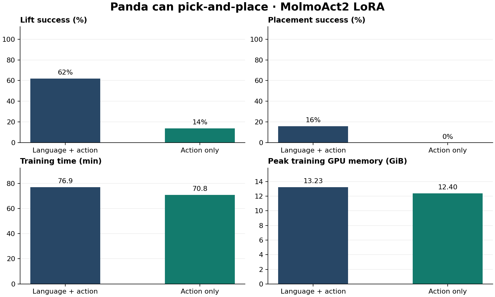

# Panda 400 demonstrations · MolmoAct2 LoRA scope comparison

Both runs use the same Panda can demonstration data and the same starting checkpoint. Training uses seed 777, LoRA rank 32, batch size 4, and 4,000 optimizer updates. The evaluations use the same 50 MuJoCo initial states, seeds 30000–30049.

| LoRA placement | Lift | Place | Training time | Peak training GPU memory | Trainable parameters |
| --- | ---: | ---: | ---: | ---: | ---: |
| Language backbone + action expert | 31/50 (62%) | 8/50 (16%) | 1h 16m 54s | 13.23 GiB | 79,331,328 |
| Action expert only | 7/50 (14%) | 0/50 (0%) | 1h 10m 50s | 12.40 GiB | 22,118,400 |

Training time runs from launching the trainer through saving the final adapter. Peak GPU memory is PyTorch's peak allocated CUDA memory during training in GiB.

- [Both scopes rollout data](../k400/summary.json)
- [Action expert only rollout data](summary.json)
- [Numeric comparison and paired outcomes](comparison.json)
